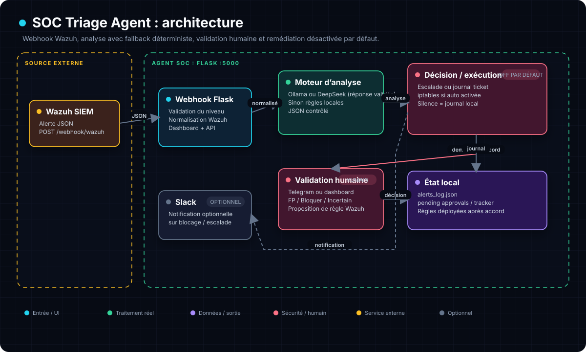

# 🤖 SOC Triage Agent: Wazuh alert triage with an LLM and human approval

<p align="center">
  <a href="README.md">English</a> &bull;
  <a href="README_fr.md">Français</a>
</p>

```
 █████╗  ██████╗ ███████╗███╗   ██╗████████╗    ██╗ █████╗     ███████╗ ██████╗  ██████╗
██╔══██╗██╔════╝ ██╔════╝████╗  ██║╚══██╔══╝    ██║██╔══██╗    ██╔════╝██╔═══██╗██╔════╝
███████║██║  ███╗█████╗  ██╔██╗ ██║   ██║       ██║███████║    ███████╗██║   ██║██║
██╔══██║██║   ██║██╔══╝  ██║╚██╗██║   ██║       ██║██╔══██║    ╚════██║██║   ██║██║
██║  ██║╚██████╔╝███████╗██║ ╚████║   ██║       ██║██║  ██║    ███████║╚██████╔╝╚██████╗
╚═╝  ╚═╝ ╚═════╝ ╚════════╝╚═╝  ╚═══╝   ╚═╝       ╚═╝╚═╝  ╚═╝    ╚══════╝ ╚═════╝  ╚═════╝
```

> **A defensive SOC agent. It receives Wazuh alerts, analyses them (LLM or heuristic), logs or executes the action permitted by the configuration, then requests a human decision on Telegram or in the dashboard. Automatic remediation is disabled by default.**

## ⚠️ What is implemented vs what is a prototype

To stay honest about the maturity level of the repository, the features are classified into two categories:

**✅ Effective (working and tested code)**
- `/webhook/wazuh` webhook + web dashboard (stats, log, history and decisions).
- Alert analysis by a **local LLM (Ollama)** or the **DeepSeek API**, with strict validation of the answer and automatic fallback to an offline **rule-based** engine.
- Human decision on **Telegram** (APPROVE / REJECT / UNSURE) + equivalent endpoints on the dashboard, notably for Wazuh rule proposals.
- IP blocking via **iptables** (`block_ip`, `block_ip_temporary` with scheduled unblocking after 1 h).
- **Slack** notification if a webhook is provided.
- **False positive** detection and generation of Wazuh silence rules.
- Action log in `alerts_log.json`, pending approvals in `pending_approvals.json`.

**🔬 Prototypes / to be connected (planned structure, not yet wired up)**
- **Disabling an Active Directory account**: **not implemented**.
- **Creation of a real GLPI ticket**: the code logs "Ticket to create" but **does not call the GLPI API**; `GLPI_URL` / `GLPI_API_TOKEN` still have to be wired up.

> Automatic remediation is **disabled by default** (`SOC_ENABLE_AUTO_REMEDIATION` variable). Without this variable set to `true`, the engine records the action but does not execute it.

[](https://python.org)
[](https://flask.palletsprojects.com/)
[](https://wazuh.com)
[](https://core.telegram.org/bots)
[](tests/)
[](LICENSE)

---

## 🎯 The problem

N1 SOC analysts regularly have to:
- Sort through **false positives** and legitimate events
- **Copy and paste** IPs into blocking tools
- Document and then get sensitive decisions validated

These repetitive tasks slow down processing and divert attention from priority incidents.

## 💡 The solution

**SOC Triage Agent** helps close the loop, from detection to decision, by reducing the time spent sorting through noise. The webhook normalises the alert, the engine analyses it, then logs or executes the action according to the configuration. Telegram and the dashboard then provide human validation for rule proposals and sensitive decisions.

---

## 🏗️ Architecture



The engine queries the configured LLM (local Ollama or DeepSeek), validates its answer, then falls back to local rules if the answer is invalid. An internal IP is never blocked automatically. Automatic remediation remains **disabled by default**: without `SOC_ENABLE_AUTO_REMEDIATION=true`, no IP block proposed by the analysis is executed. AD and GLPI integrations remain outside the effective flow.

---

## ⚡ Quick Start

```bash
# 1. Clone
git clone https://github.com/Yukouf/soc-triage-agent.git && cd soc-triage-agent

# 2. Dependencies
pip install -r requirements.txt

# 3. Configure (see the table below)
export SOC_TELEGRAM_BOT_TOKEN="your_token"
export SOC_TELEGRAM_ALLOWED_CHAT_IDS="123456789"
export SOC_WEBHOOK_TOKEN="a_long_secret"
export SOC_LLM_PROVIDER="ollama"

# 4. Run
python3 webhook_receiver.py
```

### Configuration

| Variable | Purpose | Default |
|---|---|---|
| `SOC_TELEGRAM_BOT_TOKEN` | Telegram bot token | none (Telegram disabled) |
| `SOC_TELEGRAM_ALLOWED_CHAT_IDS` | Accounts allowed to receive alerts and decide (`"123,456"`). In a group: the group ID **and** each analyst's ID | empty = nobody |
| `SOC_WEBHOOK_TOKEN` | Secret Wazuh must send in the `X-SOC-Token` header | none (warning at startup) |
| `SOC_DASHBOARD_PASSWORD` / `SOC_DASHBOARD_USER` | Dashboard access (HTTP Basic). Without a password, decisions from the dashboard are disabled | none / `soc` |
| `SOC_DASHBOARD_URL` | Link shown in Telegram | none |
| `SOC_LLM_PROVIDER` | `ollama`, `deepseek` or `none` | `deepseek` if a key exists, else `none` |
| `OLLAMA_URL` / `SOC_OLLAMA_MODEL` | Local model | `http://127.0.0.1:11434` / `qwen2.5:7b` |
| `DEEPSEEK_API_KEY` | DeepSeek key (alerts are then sent to an external API) | none |
| `SOC_ENABLE_AUTO_REMEDIATION` | Allows automatic actions | `false` |
| `SOC_WEBHOOK_HOST` / `SOC_WEBHOOK_PORT` | Server listener | `127.0.0.1` / `5000` |
| `SLACK_WEBHOOK_URL` | Slack notifications | none |

---

## 🧠 How it works

### 1. Wazuh alert → Webhook

Wazuh sends its alerts to the `/webhook/wazuh` webhook:

```json
{
  "rule": {
    "id": "100002",
    "level": 10,
    "description": "Bruteforce SSH detected from 192.168.1.100"
  },
  "data": {
    "srcip": "192.168.1.100",
    "srcuser": "root"
  }
}
```

### 2. Analysis by AI

`ai_engine.py` analyses the alert and returns:

```json
{
  "severity": "high",
  "confidence": 92,
  "explanation": "15 SSH attempts in 30 seconds from an unknown external IP. No legitimate reason.",
  "suggested_action": "block_ip",
  "is_false_positive": false
}
```

### 3. Human validation on Telegram

Every alert that needs a decision is sent to Telegram, to allowed accounts only:

> 🤖 **Décision requise**
> 📋 Source rule: `#5712` | 🌐 Source IP: `203.0.113.45`
> 🔍 Description: `sshd: brute force trying to get access`
>
> [✅ Approve (FP)] [❌ Reject (Block)] [⏸️ Unsure]

### 4. Remediation

If approved **and** if automatic remediation is enabled (`SOC_ENABLE_AUTO_REMEDIATION=true`), `remediation_engine.py` executes:

| Action | State | Behaviour |
|---|---|---|
| `block_ip` | ✅ effective | `iptables -A INPUT -s IP -j DROP` |
| `block_ip_temporary` | ✅ effective | 1 h block then automatic removal |
| `silence_alert` | ✅ effective | Records the false positive + Wazuh silence rule |
| `notify_slack` | ✅ effective | Slack alert (if webhook provided) |
| `verify_and_escalate` | ✅ effective | Escalation to the human (log + Slack) |
| `create_ticket` | ⚠️ partial | Logs "Ticket to create". The GLPI API call still has to be wired up |
| `disable_user_ad` | ❌ not implemented | Planned, not in the engine |

> **Important:** if automatic remediation is disabled (the default setting), these actions are **recorded in the log** but **never executed**: human validation remains mandatory.

---

## 📊 Web dashboard

Minimal server-rendered interface, with client-side JavaScript limited to auto-refresh and approval actions:

- 🔴 **Active alerts** with severity and confidence
- 📋 **History** of remediations
- 📈 **Statistics** (false positives, executed actions)
- 🔍 **Detail** per alert

---

## 🧪 Tests

```bash
python3 -m unittest discover -s tests -v
```

32 tests, including:
- **triage**: an attack from an internal IP is never classified as a false positive nor blocked automatically;
- **LLM output**: strict types and values (`"false"` as text, unknown action or out-of-range confidence are rejected);
- **Telegram**: an unauthorised account receives nothing and its clicks are ignored;
- **dashboard and webhook**: password, anti-CSRF header and shared secret;
- **XSS**: all untrusted data is escaped.

---

## 🔒 Security

- ✅ Closed list of allowed Telegram accounts (empty = nobody)
- ✅ Webhook protected by a shared secret, dashboard by a password and an anti-CSRF header
- ✅ Alert passed to the LLM as untrusted data, answer strictly validated (prompt-injection defence)
- ✅ LLM-independent guardrail: an internal IP is never blocked automatically
- ✅ Automatic remediation disabled by default
- ✅ HTML escaping of all untrusted data (XSS)
- ✅ Fully local option with Ollama: no alert leaves the machine

---

## 📁 Structure

```
soc-triage-agent/
├── webhook_receiver.py    # Flask server + dashboard + endpoints
├── ai_engine.py            # Alert analysis (LLM + rules) and validation
├── remediation_engine.py   # Action execution
├── telegram_bot.py         # Telegram bot (polling + notifications)
├── wazuh_rule_manager.py   # Wazuh silence-rule management
├── sample_alerts.py        # Test alert set
├── test_fp.py              # Sends test alerts to the webhook
├── tests/
│   └── test_security.py    # 32 tests
└── assets/architecture.svg # Architecture diagram
```

Files generated at runtime: `alerts_log.json`, `fp_tracker.json`, `pending_approvals.json`.

---

## 🛣️ Roadmap

- [ ] Native Discord integration (in addition to Telegram)
- [x] Automatic false positive detection
- [x] Lightweight dashboard with client-side refresh and decisions
- [ ] Advanced remediation playbooks (SOAR)
- [ ] Multi-tenant support
- [ ] PDF export of incident reports

---

## ⚖️ License

MIT, do what you want with it. Fork, improve, deploy. Just credit the author.

---

*Built with ❤️‍🔥 by [Youssef Guerniou](https://github.com/Yukouf), because SOCs deserve better than copy and paste.*
