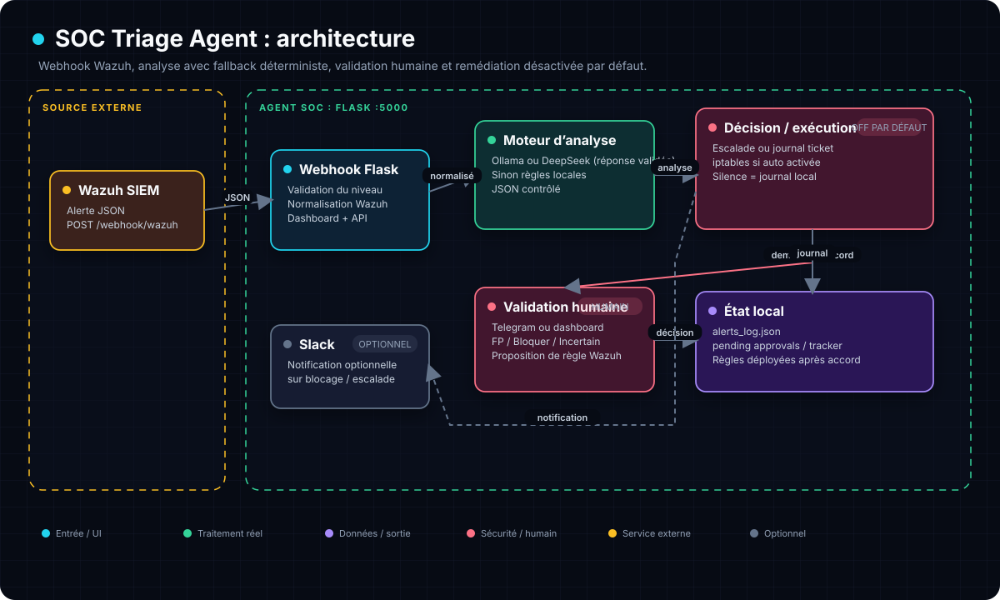

# 🤖 SOC Triage Agent : tri des alertes Wazuh avec un LLM et validation humaine

<p align="center">
  <a href="README.md">English</a> &bull;
  <a href="README_fr.md">Français</a>
</p>

```
 █████╗  ██████╗ ███████╗███╗   ██╗████████╗    ██╗ █████╗     ███████╗ ██████╗  ██████╗
██╔══██╗██╔════╝ ██╔════╝████╗  ██║╚══██╔══╝    ██║██╔══██╗    ██╔════╝██╔═══██╗██╔════╝
███████║██║  ███╗█████╗  ██╔██╗ ██║   ██║       ██║███████║    ███████╗██║   ██║██║
██╔══██║██║   ██║██╔══╝  ██║╚██╗██║   ██║       ██║██╔══██║    ╚════██║██║   ██║██║
██║  ██║╚██████╔╝███████╗██║ ╚████║   ██║       ██║██║  ██║    ███████║╚██████╔╝╚██████╗
╚═╝  ╚═╝ ╚═════╝ ╚════════╝╚═╝  ╚═══╝   ╚═╝       ╚═╝╚═╝  ╚═╝    ╚══════╝ ╚═════╝  ╚═════╝
```

> **Un agent SOC défensif. Il reçoit les alertes Wazuh, les analyse (LLM ou heuristique), journalise ou exécute l’action autorisée par la configuration, puis sollicite une décision humaine sur Telegram ou dans le dashboard. La remédiation automatique est désactivée par défaut.**

## ⚠️ Ce qui est implémenté vs ce qui est un prototype

Pour rester honnête sur le niveau de maturité du dépôt, les fonctionnalités sont classées en deux catégories :

**✅ Effectives (code fonctionnel et testé)**
- Webhook `/webhook/wazuh` + dashboard web (stats, journal, historique et décisions).
- Analyse d'alerte par un **LLM local (Ollama)** ou par l'**API DeepSeek**, avec validation stricte de la réponse et repli automatique sur un moteur **à règles** hors ligne.
- Décision humaine sur **Telegram** (APPROUVER / REJETER / INCERTAIN) + endpoints équivalents sur le dashboard, notamment pour les propositions de règles Wazuh.
- Blocage IP via **iptables** (`block_ip`, `block_ip_temporary` avec déblocage planifié à 1 h).
- Notification **Slack** si un webhook est fourni.
- Détection des **faux positifs** et génération de règles de silence Wazuh.
- Journal des actions dans `alerts_log.json`, approbations en attente dans `pending_approvals.json`.

**🔬 Prototypes / à connecter (structure prévue, pas encore câblée)**
- **Désactivation d'un compte Active Directory** : **non implémentée**.
- **Création d'un vrai ticket GLPI** : le code loggue « Ticket à créer » mais **n'appelle pas l'API GLPI** ; il faut brancher `GLPI_URL` / `GLPI_API_TOKEN`.

> La remédiation automatique est **désactivée par défaut** (variable `SOC_ENABLE_AUTO_REMEDIATION`). Sans cette variable à `true`, le moteur enregistre l'action mais ne l'exécute pas.

[](https://python.org)
[](https://flask.palletsprojects.com/)
[](https://wazuh.com)
[](https://core.telegram.org/bots)
[](tests/)
[](LICENSE)

---

## 🎯 Le problème

Les analystes SOC N1 doivent régulièrement :
- Trier des **faux positifs** et des événements légitimes
- **Copier-coller** des IP dans des outils de blocage
- Documenter puis faire valider les décisions sensibles

Ces tâches répétitives ralentissent le traitement et détournent l’attention des incidents prioritaires.

## 💡 La solution

**SOC Triage Agent** aide à aller de la détection à la décision, en passant moins de temps à trier le bruit. Le webhook normalise l’alerte, le moteur l’analyse, puis journalise ou exécute l’action selon la configuration. Telegram et le dashboard fournissent ensuite une validation humaine pour les propositions de règles et les décisions sensibles.

---

## 🏗️ Architecture



Le moteur interroge le LLM configuré (Ollama en local ou DeepSeek), valide sa réponse, puis bascule sur des règles locales si elle est invalide. Une IP interne n'est jamais bloquée automatiquement. La remédiation automatique reste **désactivée par défaut** : sans `SOC_ENABLE_AUTO_REMEDIATION=true`, aucun blocage IP proposé par l'analyse n'est exécuté. Les intégrations AD et GLPI restent hors du flux effectif.

---

## ⚡ Quick Start

```bash
# 1. Cloner
git clone https://github.com/Yukouf/soc-triage-agent.git && cd soc-triage-agent

# 2. Dépendances
pip install -r requirements.txt

# 3. Configurer (voir le tableau ci-dessous)
export SOC_TELEGRAM_BOT_TOKEN="votre_token"
export SOC_TELEGRAM_ALLOWED_CHAT_IDS="123456789"
export SOC_WEBHOOK_TOKEN="un_secret_long"
export SOC_LLM_PROVIDER="ollama"

# 4. Lancer
python3 webhook_receiver.py
```

### Configuration

| Variable | Rôle | Défaut |
|---|---|---|
| `SOC_TELEGRAM_BOT_TOKEN` | Jeton du bot Telegram | aucun (Telegram désactivé) |
| `SOC_TELEGRAM_ALLOWED_CHAT_IDS` | Comptes autorisés à recevoir les alertes et à décider (`"123,456"`). Dans un groupe : l'ID du groupe **et** celui de chaque analyste | vide = personne |
| `SOC_WEBHOOK_TOKEN` | Secret que Wazuh doit envoyer dans l'en-tête `X-SOC-Token` | aucun (avertissement au démarrage) |
| `SOC_DASHBOARD_PASSWORD` / `SOC_DASHBOARD_USER` | Accès au dashboard (HTTP Basic). Sans mot de passe, les décisions depuis le dashboard sont désactivées | aucun / `soc` |
| `SOC_DASHBOARD_URL` | Lien affiché dans Telegram | aucun |
| `SOC_LLM_PROVIDER` | `ollama`, `deepseek` ou `none` | `deepseek` si une clé existe, sinon `none` |
| `OLLAMA_URL` / `SOC_OLLAMA_MODEL` | Modèle local | `http://127.0.0.1:11434` / `qwen2.5:7b` |
| `DEEPSEEK_API_KEY` | Clé DeepSeek (les alertes sont alors envoyées à une API externe) | aucune |
| `SOC_ENABLE_AUTO_REMEDIATION` | Autorise les actions automatiques | `false` |
| `SOC_WEBHOOK_HOST` / `SOC_WEBHOOK_PORT` | Écoute du serveur | `127.0.0.1` / `5000` |
| `SLACK_WEBHOOK_URL` | Notifications Slack | aucun |

---

## 🧠 Comment ça marche

### 1. Alerte Wazuh → Webhook

Wazuh envoie ses alertes au webhook `/webhook/wazuh` :

```json
{
  "rule": {
    "id": "100002",
    "level": 10,
    "description": "Bruteforce SSH detected from 192.168.1.100"
  },
  "data": {
    "srcip": "192.168.1.100",
    "srcuser": "root"
  }
}
```

### 2. Analyse par IA

L'`ai_engine.py` analyse l'alerte et retourne :

```json
{
  "severity": "high",
  "confidence": 92,
  "explanation": "15 tentatives SSH en 30 secondes depuis une IP externe inconnue. Aucune raison légitime.",
  "suggested_action": "block_ip",
  "is_false_positive": false
}
```

### 3. Validation humaine sur Telegram

Chaque alerte qui demande une décision arrive sur Telegram, uniquement chez les comptes autorisés :

> 🤖 **Décision requise**
> 📋 Règle source : `#5712` | 🌐 IP source : `203.0.113.45`
> 🔍 Description : `sshd: brute force trying to get access`
>
> [✅ Approuver (FP)] [❌ Rejeter (Bloquer)] [⏸️ Incertain]

### 4. Remédiation

Si approuvé **et** si la remédiation automatique est activée (`SOC_ENABLE_AUTO_REMEDIATION=true`), le `remediation_engine.py` exécute :

| Action | État | Comportement |
|---|---|---|
| `block_ip` | ✅ effectif | `iptables -A INPUT -s IP -j DROP` |
| `block_ip_temporary` | ✅ effectif | Blocage 1 h puis suppression auto |
| `silence_alert` | ✅ effectif | Enregistre le faux positif + règle de silence Wazuh |
| `notify_slack` | ✅ effectif | Alerte Slack (si webhook fourni) |
| `verify_and_escalate` | ✅ effectif | Escalade vers l'humain (log + Slack) |
| `create_ticket` | ⚠️ partiel | Loggue « Ticket à créer ». L'appel API GLPI reste à brancher |
| `disable_user_ad` | ❌ non implémenté | Prévu, absent du moteur |

> **Important :** si la remédiation automatique est désactivée (réglage par défaut), ces actions sont **enregistrées dans le journal** mais **jamais exécutées**. La validation humaine reste obligatoire.

---

## 📊 Dashboard web

Interface minimale rendue côté serveur, avec un JavaScript client limité à l’auto-rafraîchissement et aux actions d’approbation :

- 🔴 **Alertes actives** avec sévérité et confiance
- 📋 **Historique** des remédiations
- 📈 **Statistiques** (faux positifs, actions exécutées)
- 🔍 **Détail** par alerte

---

## 🧪 Tests

```bash
python3 -m unittest discover -s tests -v
```

32 tests, dont :
- **tri** : une attaque venant d'une IP interne n'est jamais classée comme faux positif ni bloquée automatiquement ;
- **sortie du LLM** : types et valeurs stricts (`"false"` en texte, action inconnue ou confiance hors plage sont rejetés) ;
- **Telegram** : un compte non autorisé ne reçoit rien et ses clics sont ignorés ;
- **dashboard et webhook** : mot de passe, en-tête anti-CSRF et secret partagé ;
- **XSS** : toutes les données non fiables sont échappées.

---

## 🔒 Sécurité

- ✅ Liste fermée de comptes Telegram autorisés (vide = personne)
- ✅ Webhook protégé par un secret partagé, dashboard par mot de passe et en-tête anti-CSRF
- ✅ Alerte transmise au LLM comme donnée non fiable, réponse validée strictement (anti injection de prompt)
- ✅ Garde-fou indépendant du LLM : jamais de blocage automatique d'une IP interne
- ✅ Remédiation automatique désactivée par défaut
- ✅ Échappement HTML de toutes les données non fiables (XSS)
- ✅ Option 100 % locale avec Ollama : aucune alerte ne quitte la machine

---

## 📁 Structure

```
soc-triage-agent/
├── webhook_receiver.py    # Serveur Flask + dashboard + endpoints
├── ai_engine.py            # Analyse des alertes (LLM + règles) et validation
├── remediation_engine.py   # Exécution des actions
├── telegram_bot.py         # Bot Telegram (polling + notifications)
├── wazuh_rule_manager.py   # Gestion des règles de silence Wazuh
├── sample_alerts.py        # Jeu d'alertes de test
├── test_fp.py              # Envoie des alertes de test au webhook
├── tests/
│   └── test_security.py    # 32 tests
└── assets/architecture.svg # Schéma d'architecture
```

Fichiers générés à l'exécution : `alerts_log.json`, `fp_tracker.json`, `pending_approvals.json`.

---

## 🛣️ Roadmap

- [ ] Intégration native Discord (en plus de Telegram)
- [x] Détection automatique des faux positifs
- [x] Dashboard léger avec rafraîchissement et décisions côté client
- [ ] Playbooks de remédiation avancés (SOAR)
- [ ] Support multi-tenants
- [ ] Export PDF des rapports d'incidents

---

## ⚖️ Licence

MIT. Fais-en ce que tu veux. Fork, améliore, déploie. Juste, crédite l'auteur.

---

*Built with ❤️‍🔥 by [Youssef Guerniou](https://github.com/Yukouf), parce que les SOC méritent mieux que des copier-coller.*
